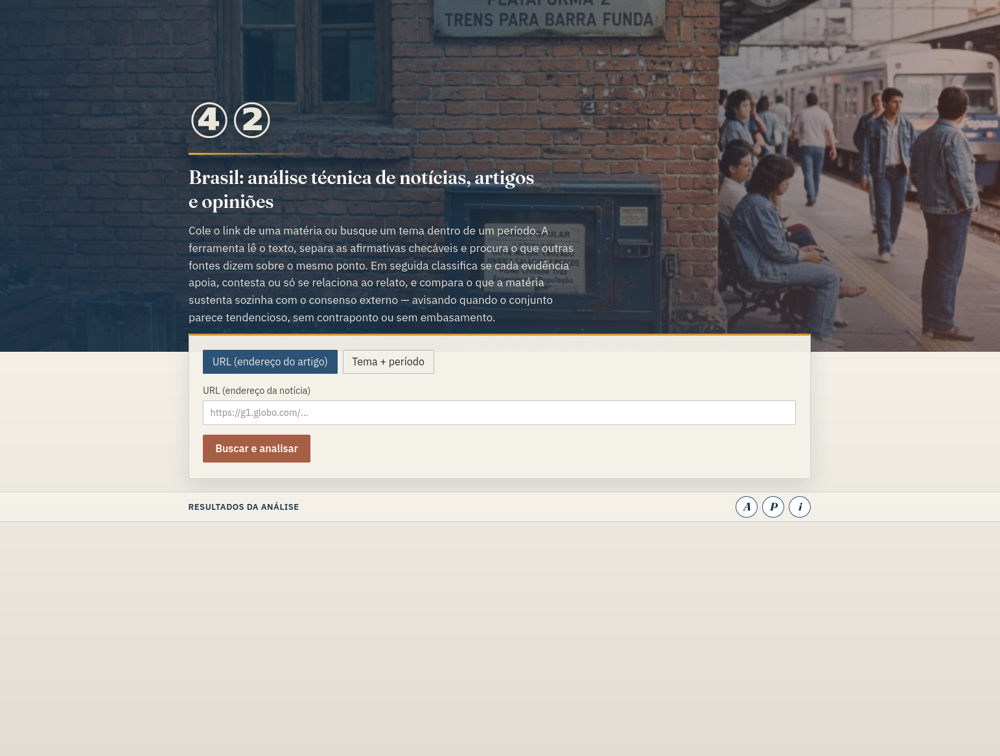

# ④②

App híbrido (Python + Angular) para coletar notícias brasileiras, guardar fonte/autor/conteúdo/data e devolver uma análise preliminar. Usa o catálogo de fontes do Frank Investigator (copiado) e mantém os projetos originais só como referência local em `_reference/` (ignorada pelo Git).



## Estrutura

- `backend/` — FastAPI + SQLite
- `frontend/` — Angular (busca por URL ou tema + período)
- `_reference/` — cópia local dos projetos originais (não versionada)
- `docs/` — modelos de documentação
- `docker-compose.yml` — sobe API + UI (Nginx)

Os quatro projetos originais em `../` **não foram apagados**.

## Docker (recomendado)

```bash
cd 42
docker compose up --build
```

- App: `http://localhost:8080`
- API docs (via proxy): `http://localhost:8080/docs`
- Dados SQLite no volume `veracidade_data`

Parar: `docker compose down`

## Backend (local, sem Docker)

```bash
cd backend
python3 -m venv .venv
source .venv/bin/activate
pip install -r requirements.txt
uvicorn app.main:app --reload --port 8000
```

API: `http://127.0.0.1:8000/docs`

- `POST /api/ingest/url` — `{ "url": "https://..." }`
- `POST /api/search/topic` — `{ "topic": "...", "date_from": "2026-10-01", "date_to": "2026-10-20" }`

**LLM:** desligada por padrão. Claims, filtro de tema e resumos usam heurísticas no código.

## Acervo de análises (SQLite)

O banco local é o arquivo de análises reutilizáveis:

- Artigo: título, autor, link, data, ownership (grupo), corpo
- Links citados no HTML (`article_outbound_links`)
- Claims (F3), cruzamento (F4) e **snapshot** da análise (`article_analyses`)
- Em nova busca, peers do **mesmo claim** no acervo entram primeiro; stance pode ser reutilizada (`method=acervo`)
- Resposta com `analysis_cached: true` quando o snapshot bate com o `content_hash`
- `POST /api/articles/{id}/reanalyze` força nova análise; ingest com `{ "refresh": true }` rebaixa a URL

## Frontend (local, sem Docker)

```bash
cd frontend
npm install
npm start
```

Abra `http://localhost:4200` (API em `http://127.0.0.1:8000`).

## Redes neurais locais (complemento)

Camada opcional (estilo fake-news-detector): **não substitui** heurísticas, catálogo YAML nem OpenRouter.

| Sinal | Onde | Modelo padrão |
| --- | --- | --- |
| NLI (stance) | F4 `stance.py` | mDeBERTa XNLI multilingual |
| Embeddings | ranking de pares F4 | paraphrase-multilingual-MiniLM |
| Clickbait | funde em Distortion F3 | via embeddings título×corpo |

```bash
# local
cd backend
pip install -r requirements.txt
pip install -r requirements-nn.txt   # torch + transformers (pesado)

# Docker com NN na imagem
INSTALL_NN=1 docker compose up --build
```

Sem os pacotes NN, o `/api/health` mostra `nn.packages_installed: false` e o pipeline segue só com heurística/LLM. Detalhes: `docs/fluxo-atual-e-redes.md`.

## Limites do MVP

- Stance usa heurística; NLI/LLM entram só se configurados e disponíveis.
- Busca web depende do DuckDuckGo e pode falhar/limitar resultados.
- Bias do catálogo é julgamento curado, não prova de verdade.
- Não substitui checagem humana nem fact-checkers profissionais.


Analisei alguns projetos  do github para saber por onde começar e deixo aqui ,meus agradecimentos.

[Fake News Detection](https://github.com/muqadasejaz/Fake-News-Detection) de [muqadasejaz](https://github.com/muqadasejaz )
[Media Bias Fact Check Data Collection](https://github.com/CASOS-IDeaS-CMU/media_bias_fact_check_data_collection ) de [iem5](https://github.com/iem5 )
[Fake News Detector](https://github.com/aubynsamuel/fake-news-detector ) de [aubynsamuel](https://github.com/aubynsamuel )
[Frank Investigator](https://github.com/akitaonrails/frank_investigator ) de [akitaonrails](https://github.com/akitaonrails )