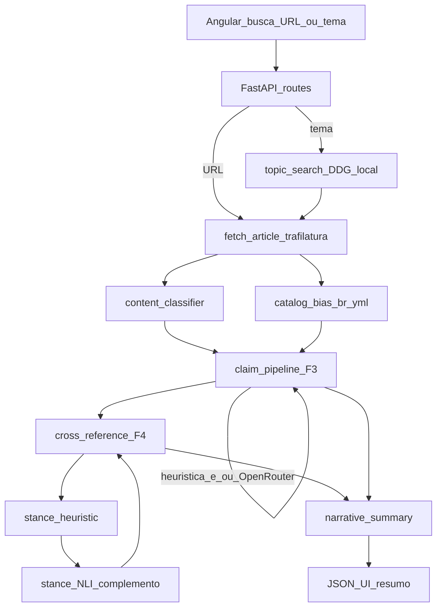
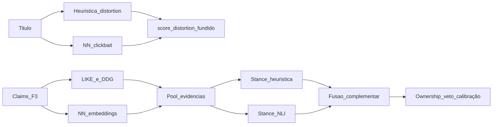

# Fluxo atual do projeto e onde redes neurais atuariam (complemento)

Documento de referência do estado **hoje** do `veracidade-noticias` e do mapa de inserção de redes neurais locais (estilo `fake-news-detector`) como **camada complementar**.

## Princípio: complementar, não substituir

- Heurísticas, catálogo YAML e OpenRouter (quando houver chave) **continuam**.
- Redes neurais locais entram como **sinais extras** (scores, candidatos, confiança NLI).
- Se o modelo falhar ou não estiver instalado: o pipeline segue só com o que já existe hoje.
- Na agregação, NN **ajusta peso / confiança**; não apaga o resultado heurístico nem o LLM.

Exemplo na Stance (posição da evidência): `heuristic` + `nli` → consenso interno (ex.: média ponderada, ou “NLI reforça se concordar; se discordar, baixa confiança e registra os dois métodos”).

---

## Arquitetura em uma frase

Angular chama FastAPI → coleta/parse → perfil de fonte → Claims (F3) → Cross-reference (F4) → resumo. LLM opcional via OpenRouter. **NN locais** (NLI, embeddings, clickbait) entram como complemento quando `requirements-nn.txt` está instalado e as flags `NN_*` estão ligadas; sem isso o pipeline segue só com heurística/LLM.

---

## Passo a passo — modo URL

Entrada: usuário cola link → `POST /api/ingest/url` (`backend/app/api/routes.py`).

1. **Fetch e parse** — `backend/app/services/fetch_article.py`  
   HTML → título/autor/corpo/data (trafilatura), URL normalizada, tabela `articles`.

2. **Resolver fonte** — `backend/source_profiles.yml` + `backend/catalog/bias_br.yml`  
   Ownership (grupo dono), Tier (nível de autoridade), Bias (viés). Catálogo curado — redes **não** substituem isso.

3. **Tipo de conteúdo** — `backend/app/services/content_classifier.py`  
   Regras/regex hoje (article, opinion, editorial, official_document, etc.). NN futura só como score auxiliar.

4. **Claims (F3)** — `backend/app/services/claim_pipeline.py`  
   Extrai afirmativas e scores (temporal, geo, partisan, distortion, support).  
   Hoje: heurística (`heuristic_claims.py`) e/ou OpenRouter (`llm_client.py`).  
   Clickbait neural (`nn_clickbait.py`) **soma** em `score_distortion` quando embeddings estão disponíveis.

5. **Análise de fonte** — `backend/app/services/analyze.py`  
   Perfil + claims → veredito preliminar isolado.

6. **Cross-reference (F4)** — `backend/app/services/cross_reference.py`  
   Por claim: busca pares (local/web via `web_search.py`), classifica Stance em `stance.py` (overlap/negação).  
   Agrega com Ownership, veto de fonte primária e Calibration (calibração F3 vs F4).  
   **Complemento NN:** (a) `nn_embeddings.py` reordena candidatos do LIKE; (b) `nn_nli.py` (mDeBERTa) funde com a heurística em `stance.py` (`method=heuristic+nli`); Ownership/veto/calibração permanecem.

7. **Resumo narrativo** — `backend/app/services/narrative_summary.py`  
   Parágrafos em português no campo `narrative_summary`. Pode citar quando NLI concordou ou divergiu da heurística.

8. **UI** — Angular exibe badges, claims, cruzamento e o resumo; método `heuristic+nli` quando a fusão NLI rodou.

---

## Passo a passo — modo tema + período

Entrada: `POST /api/search/topic` → `backend/app/services/topic_search.py`.

1. Busca no corpus local (SQLite) por **todos** os tokens principais do tema (AND) e intervalo de data (se houver).  
2. Busca web: **sem período** prioriza `text` (histórico); **com período** usa `news` + `text` e `timelimit` só se o intervalo for curto. Query com frase entre aspas.  
3. **Filtro de relevância** estrito (`topic_relevance.py`): frase/tokens no título, lexical alto; embeddings só reforçam — não aprovam sozinhos.  
4. Para cada artigo aceito: F2 → F3 → F4 usando os **outros artigos do lote** como pool.  
5. Panorama mostra quantos candidatos foram descartados + resumo do tema.

---

## Hoje vs complemento neural

| Etapa | Continua existindo | NN complementar (não substitui) |
| --- | --- | --- |
| Parse HTML | trafilatura | — |
| Tipo de conteúdo | regex | Score auxiliar opcional |
| Bias/Ownership | YAML curado | Não usar NN no lugar do catálogo |
| Extração de claims | heurística / OpenRouter | Claim spotting só como reforço |
| Scores F3 | heurística / OpenRouter | Clickbait neural soma em distortion |
| Stance F4 | overlap + negação (+ LLM opcional) | **DeBERTa NLI** como segundo voto |
| Pares | LIKE + DuckDuckGo | **Embeddings** para ranquear/ampliar candidatos |
| Agregação F4 | Ownership, veto, calibração | Usa confiança NLI no peso; regras ficam |
| Resumo | template PT | Sem mudança obrigatória |

---

## Encaixe das redes do fake-news-detector (complemento)

Referência: `fake-news-detector-main` (`nli_checks.py`, `semantic_similarity.py`, pipeline de clickbait).

1. **Stance (F4)** — em `stance.py`: manter `stance_heuristic`; adicionar NLI (como `nli_checks.py`); fundir (se concordam, sobe confiança; se discordam, `related` / evidência fraca com baixa confiança e `method=heuristic+nli`).

2. **Retrieval** — sentence-transformers para **priorizar** pares no banco; LIKE e busca web seguem gerando candidatos.

3. **Clickbait** — score neural **adicionado** à Distortion heurística (média ou max), sem remover regras de título sensacionalista.

Fusão no pipeline:

**Implementado:** (1) NLI em `stance.py` + `nn_nli.py`, (2) embeddings em `_local_peers` / `nn_embeddings.py`, (3) clickbait em `heuristic_claims.py` / `nn_clickbait.py`. Flags `NN_ENABLED`, `NN_NLI_ENABLED`, `NN_EMBEDDINGS_ENABLED`, `NN_CLICKBAIT_ENABLED`. Instalação: `pip install -r requirements-nn.txt` ou Docker com `INSTALL_NN=1`.

---

## Observações

- OpenRouter continua sendo a via de LLM externa opcional; NN locais são outra camada (offline-friendly, custo previsível de GPU/CPU).  
- Bias/Ownership do catálogo BR não devem ser “preditos” por rede no lugar do julgamento curado versionado.  
- Ver também: `plano-inicial.md`, `fase-3-claims.md`, `fase-4-cruzamento.md`, `catalogo-bias.md`.
