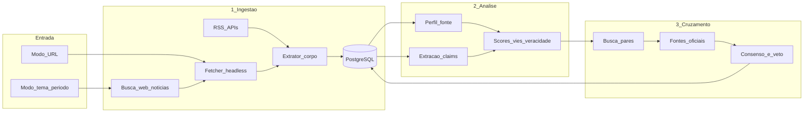

# Plano inicial: App de Veracidade de Notícias (Brasil, híbrido)

Documento de planejamento do projeto. Escopo: Brasil-first; arquitetura nova em Python com reaproveitamento de perfis/padrões dos projetos de referência; uso por URL e por tema+período.

## Decisão de arquitetura

- **Produto novo** (não um fork do Frank): serviços em **Python (FastAPI)** + **PostgreSQL** + fila (**Redis/RQ ou Celery**), UI simples depois.
- **Reaproveitar**, não reinventar:
  - Registro BR de fontes e tiers de autoridade de `frank_investigator-master/config/source_profiles.yml` (seção `brazil:` — IBGE, Agência Brasil, Folha, G1, etc.).
  - Princípios e pipeline do Frank: claims canônicos → evidência → autoridade > volume → veto de fonte primária.
  - Ideias de NLI/credibilidade de `fake-news-detector-main` (claim vs evidência).
  - Catálogo de bias de outlets como *inspiração* de `media_bias_fact_check_data_collection-main` — **não** depender só do MBFC (foco EUA); criar catálogo BR próprio.
  - O classificador Kaggle TF-IDF de `Fake-News-Detection-main` fica só como baseline experimental, **não** como veredito do produto.
- Escopo geográfico: **Brasil / PT-BR primeiro**; schemas e `audience_country` já preparados para expandir.

### Modos de uso (entrada do usuário)

Dois caminhos de primeira classe — não só colar link:

1. **Por URL** — analisa um artigo específico (e depois expande evidências).
2. **Por tema + tempo** — usuário informa tema/assunto e restrição temporal:
   - **data** (ex.: `2026-10-15`) ou
   - **período** (ex.: `2026-10-01` … `2026-10-20`, ou atalhos `últimos 7 dias` / `este mês`).
   - Opcional: limitar veículos, tipo de conteúdo, ou só fontes oficiais.

Fluxo do modo tema: consulta → coleta candidatos no intervalo → dedupe → agrupa por evento/claim → roda análise (passo 2) e cruzamento (passo 3) no *conjunto*, não em um único link.



---

## Passo 1 — Coleta e persistência

**Objetivo:** várias notícias de veículos distintos, com fonte, autor, conteúdo e data — a partir de URL **ou** de tema+período.

### Fontes de entrada (prioridade BR)

| Prioridade | Mecanismo | Exemplos |
| --- | --- | --- |
| P0 | RSS / Atom oficiais dos veículos | G1, Folha, UOL, Estadão, BBC Brasil, Agência Brasil |
| P0 | URL avulsa (usuário cola link) | Qualquer artigo público |
| P0 | Busca por tema + data/período | “reforma tributária” + `2026-10-01..2026-10-20` |
| P1 | Busca para pares (passo 3) | Reusa o mesmo motor de busca do modo tema |
| P2 | Conectores oficiais | Planalto, Câmara, Senado, STJ/STF, IBGE, BCB, Diário Oficial |

### Motor de busca por tema

- Query: `tema` + filtros `date_from` / `date_to` (ou `on_date`).
- Provedores (nessa ordem de preferência):
  1. **Corpus local** — artigos já ingeridos via RSS com `published_at` no intervalo (rápido, barato, offline-friendly).
  2. **API de notícias** — NewsAPI / GNews / Similar (quando houver chave), com `q` + `from`/`to` + `language=pt` + país BR.
  3. **Busca web com recorte temporal** — Serper/Brave ou DuckDuckGo + operadores de data; depois fetch das URLs.
- Pós-busca: filtrar só domínios do catálogo BR (ou permitir “qualquer fonte” com flag), limitar N resultados (ex.: 20–50), enfileirar fetch/parse.
- Índices no Postgres: `published_at`, FTS em `title`+`body` (português), depois embeddings para similaridade semântica do tema.

Evitar scraping agressivo sem respeito a `robots.txt`, rate limit e ToS. Preferir RSS + busca pontual + fetch das URLs retornadas.

### Ferramentas

- **Extração de artigo:** `trafilatura` ou `newspaper4k` (melhor que HTML cru).
- **Fetch difícil (paywall leve / JS):** Chromium headless (`playwright`) — mesmo papel do Ferrum no Frank.
- **Normalização de URL + fingerprint** do conteúdo (hash) para deduplicar republicações.
- **Agendamento:** APScheduler ou Celery Beat para varrer feeds.

### Modelo de dados mínimo

```text
sources          id, name, domain, kind, bias_score, authority_tier, ownership_group, country
articles         id, source_id, url, title, author, body, published_at, fetched_at, content_hash, content_type
article_links    source_article_id, target_url, anchor_text
topic_queries    id, topic_text, date_from, date_to, filters_json, status, created_at
query_articles   topic_query_id, article_id, rank, discovery_method
claims           id, canonical_text, entities, time_scope, place_scope, checkability
article_claims   article_id, claim_id
assessments      claim_id, scores JSON, verdict, confidence, method, created_at
evidence_items   claim_id, article_id|url, stance, weight, provenance
```

Campos pedidos: **fonte** → `sources`; **escritor** → `author`; **conteúdo** → `body`; **data** → `published_at`.  
Modo tema: `topic_queries` + `query_articles` amarra o conjunto coletado naquele período.

### Entregável do passo 1

CLI/API:

- `ingest feed` / `ingest url`
- `search topic "…" --from YYYY-MM-DD --to YYYY-MM-DD` → grava `topic_query`, coleta e persiste artigos

Query por veículo, data e tema. Sem análise ainda.

### Reaproveitamento concreto

- Seed inicial de `sources` a partir do bloco `brazil:` do `source_profiles.yml`.
- Padrão de grafo artigo→links do Frank (`articles` + `article_links`).

---

## Passo 2 — Análise de fonte e conteúdo

**Objetivo:** parcialidade da *fonte* + qualidade/veracidade do *conteúdo* (data, local, contexto).

### 2A — Perfil da fonte (antes do texto)

Sinais estáticos (tabela `sources` + ownership):

- Tipo: artigo, nota, post, comunicado, documento oficial, opinião/editorial.
- Empresa/grupo e `ownership_group` (evitar contar Globo/G1 como vozes independentes).
- Tier de autoridade (primary / secondary / low) — importado do Frank.
- Score de parcialidade **curado** para BR (esquerda/centro/direita ou escala −1…+1), com metodologia transparente e versão do catálogo — não “verdade absoluta”.

Ferramentas: YAML/CSV versionado no repo + opcional enriquecimento com listas públicas (IFCN, checadores BR: Aos Fatos, Lupa, Estadão Verifica).

### 2B — Análise do conteúdo

Pipeline por artigo:

1. Classificar gênero (fato vs opinião vs análise).
2. Extrair **claims checáveis** (LLM estruturado + regras); descartar opinião pura.
3. Para cada claim, avaliar dimensões (scores 0–1 + justificativa citando trechos):
   - coerência temporal (`published_at` vs datas no texto)
   - coerência geográfica/entidades (localidade BR)
   - tom partidário / framing
   - distorção narrativa (omissão, citação seletiva, clickbait título vs corpo)
   - suporte factual interno (links e números no próprio texto)

Ferramentas:

- **LLM** via OpenRouter (mesmo padrão do Frank) para scores + JSON schema.
- **Embeddings** (`sentence-transformers` multilingual ou API) para similaridade de claims.
- Heurísticas baratas: divergência título/corpo, densidade emocional vs evidência (já existem no Frank como referência de produto).
- Opcional: NLI (DeBERTa) do `fake-news-detector` para claim↔trecho.

### Saída do passo 2

Por artigo e por claim: scores + veredito preliminar (`supported` / `disputed` / `insufficient` / `opinion`) + fatores transparentes. **Não** chamar isso de “verdadeiro/falso” sem evidência externa — isso é o passo 3.

---

## Passo 3 — Cruzamento e validação da análise

**Objetivo:** confrontar o resultado com outras mídias e oficiais para validar (ou invalidar) a análise.

### Fluxo

1. Se a entrada foi **tema+período**, o corpus inicial já é o conjunto de `query_articles`; expandir só o que faltar (oficiais, gaps).
2. Se a entrada foi **URL**, para cada claim canônico buscar artigos pares (mesmo evento/entidades/janela ±N dias) — mesmo motor do modo tema.
3. Buscar documentos oficiais relevantes (perfis `primary` do catálogo BR), preferindo o mesmo intervalo temporal.
4. Classificar *stance* de cada evidência: supports / refutes / related / unrelated.
5. Agregar com regras do Frank:
   - autoridade prioriza volume
   - veto de fonte primária
   - independência editorial (um grupo = uma voz)
   - consenso LLM ponderado por confiança, não por contagem de cabeças
6. Comparar veredito do passo 2 vs consenso do grafo → **score de calibração**.

### Ferramentas

- Mesmo motor de busca do passo 1 (corpus local → NewsAPI/GNews → Serper/Brave/DDG).
- Fetch + parse iguais ao passo 1.
- Embeddings + pgvector para “investigações/temas relacionados”.
- LLM multi-modelo para consenso (OpenRouter).
- Opcional futuro: ClaimReview / Google Fact Check Tools para checagens já publicadas.

### Entregável

- Modo URL: claim → evidências → veredito → calibração.
- Modo tema: panorama do período (quantas fontes, distribuição de framing/bias, claims recorrentes, consensos e divergências) + drill-down por claim/artigo.

---

## Fases de entrega (ordem de construção)

| Fase | Nome | O que sai | Depende de |
| --- | --- | --- | --- |
| **F0** | Fundação | Repo, Postgres, modelos (`topic_queries` inclusos), seed BR, `docdir.md` | — |
| **F1** | Ingestão | RSS + URL + **busca tema/período** (corpus local + 1 provedor externo) + Playwright | F0 |
| **F2** | Perfis | Catálogo bias/ownership BR + tipo de conteúdo | F1 |
| **F3** | Claims + scores | Análise do passo 2 em artigo único **e** em lote do `topic_query` | F2 + OpenRouter |
| **F4** | Cruzamento | Pares/oficiais + agregação; no modo tema, panorama do período | F3 |
| **F5** | UI Angular | Dois formulários: URL **ou** tema + data/período; relatório progressivo | F4 |

MVP útil = **F0–F1** (já dá para listar notícias por tema/data) + **F3** em lote. Cruzamento automático = **F4**.

---

## Stack recomendada (fechada)

- Linguagem: **Python 3.12+**
- API: **FastAPI**
- DB: **PostgreSQL** (+ **pgvector** na F4)
- Jobs: **Celery** ou **RQ** + Redis
- Fetch: **httpx** + **playwright**
- Parse: **trafilatura**
- LLM: **OpenRouter** (modelos PT-friendly)
- Embeddings: sentence-transformers multilingual *ou* API OpenAI
- Config fontes: YAML (seed a partir do Frank)
- Observabilidade: logs estruturados + tabela de `llm_interactions` (auditoria)
- UI: **Angular**

Não começar em Rails só para “usar o Frank inteiro”: o híbrido extrai o valor (perfis, regras, ideias) e evita carregar o monólito Ruby no dia 1. Se no futuro quiser profundidade do Frank, expor o Frank como microserviço de “deep investigate” e chamar da API Python.

---

## Riscos e limites (deixar explícito no produto)

- Nenhuma IA prova verdade absoluta; o produto entrega **evidência + confiança + proveniência**.
- Paywalls e ToS limitam cobertura.
- Bias scores são **julgamentos curados**, versionados e revisáveis.
- Fontes oficiais também erram ou atrasam — tier alto ≠ infalível; usar veto com cuidado.
- Alinhar comunicação ao espírito IFCN: mesma régua para qualquer lado político.

---

## O que *não* fazer no início

- Treinar classificador “fake/real” só com dataset Kaggle e apresentar como fact-check.
- Scraping massivo sem fila/rate limit.
- Score único opaco (“87% verdadeiro”) sem breakdown dos fatores.
- Dependência exclusiva do MBFC para veículos brasileiros.
